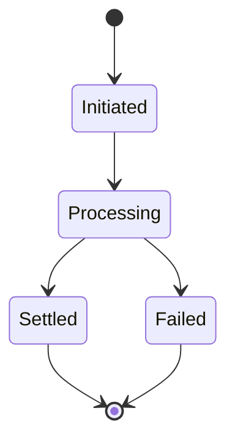

# Abacus Ledger & Reconciliation Engine

Abacus is a payment processing and accounting engine that models how a financial
system keeps transaction state correct: from the moment a payment request arrives,
through double-entry posting and period close, to daily reconciliation against
external statements.

The core engine is written in **Rust**, the reconciliation pipeline in **Python**,
with **PostgreSQL** as the system of record and **Grafana** for observability.

> **Status: active development.** Abacus is a work in progress and a learning
> project. The roadmap below shows what is built and what is planned.

---

## Why Abacus

I came to software from accounting, where the question is never just "did the
transaction go through?" but "can we prove the books are right?" Abacus applies
accounting controls as engineering constraints:

- A payment that is retried must never be recorded twice.
- Every movement of money must balance (debits = credits).
- History is never edited, only appended to.
- A closed period stays closed.
- Internal records are continuously checked against the outside world, and
  discrepancies are detected, corrected, or escalated rather than discovered
  at month end.

---

## Roadmap

| Area | Scope | Status |
| :--- | :--- | :--- |
| Core engine (Rust) | Payment state machine, double-entry journal, idempotency, PostgreSQL persistence, REST API | 🚧 In progress |
| Controls (Rust) | Append-only audit trail, period close, Grafana metrics | ⏳ Planned |
| Reconciliation (Python) | Statement ingestion, matching, break classification, auto-correction, reporting | ⏳ Planned |
| Self-healing (Rust) | Detect missing/duplicate entries, auto-correct, escalate | 🚧 In progress |
| Infrastructure | Docker Compose stack, Grafana dashboard | 🚧 In progress |
| Testing | Unit tests for ledger invariants and idempotency | ⏳ Planned |

---

## Architecture

Target architecture (components are being built incrementally; see roadmap):

```mermaid
flowchart LR
    subgraph Clients["Clients & External Systems"]
        ClientApp["Client App / Merchant"]
        ExternalBank["External Banks &<br/>Payment Gateways"]
    end

    subgraph Gateway["1. Ingress & API Gateway"]
        Auth["Auth & Rate Limiter"]
        APIRouter["API Router<br/>(REST / gRPC)"]
    end

    subgraph CoreEngine["2. Core Payment Engine (Rust)"]
        Idempotency["Idempotency Filter<br/>(UUID Key Check)"]
        StateMachine["Payment State Machine<br/>(Initiated → Processing → Settled / Failed)"]
        DoubleEntry["Double-Entry Journal<br/>(Debit & Credit Engine)"]
        AuditTrail["Audit Trail<br/>(Append-Only Event Log)"]
        PeriodClose["Period Close Manager<br/>(Freeze Books & Retained Earnings)"]
    end

    subgraph Recon["3. Reconciliation Pipeline (Python)"]
        Ingestion["Statement Ingestion<br/>(Bank / Gateway CSVs & APIs)"]
        Matcher["Matcher Engine<br/>(Auto-Match vs Breaks)"]
        Escalation["Discrepancy Escalation<br/>& Recon Ledger"]
    end

    subgraph Infrastructure["4. Storage & Observability"]
        Postgres[("PostgreSQL<br/>payments · accounts<br/>journal_entries · audit_logs")]
        Grafana["Grafana<br/>(Throughput, P&L, Breaks)"]
    end

    ClientApp -- POST /payments --> Auth
    Auth --> APIRouter
    APIRouter --> Idempotency
    Idempotency -- New request --> StateMachine
    Idempotency -. Duplicate key: cached response .-> ClientApp
    StateMachine -- Valid transition --> DoubleEntry
    DoubleEntry -- Log financial event --> AuditTrail
    PeriodClose -- Close / reconcile period --> DoubleEntry
    ExternalBank -. Daily settlement statements .-> Ingestion
    Ingestion --> Matcher
    Matcher -- Query internal entries --> Postgres
    Matcher -- Unmatched discrepancy --> Escalation
    StateMachine -- Update state --> Postgres
    DoubleEntry -- Write ledger entries --> Postgres
    AuditTrail -- Write immutable logs --> Postgres
    Postgres -. Telemetry .-> Grafana
```



---

## Design Principles

### 1. Idempotency
Every payment request carries a client-supplied UUID idempotency key. Before any
processing, the engine checks whether that key has been seen:

- **New key:** the request proceeds to the state machine.
- **Known key:** the original response is returned and nothing is reprocessed.

In payments, duplicate requests (network retries, double clicks, replayed
messages) must be accounted for and the ledger must be
immune to them.

### 2. Payment State Machine
A payment can only move through explicitly allowed transitions. Invalid
transitions are rejected rather than silently applied.



Ledger entries are only written on a valid transition, so the books always reflect
a payment's true state.

### 3. Double-Entry Journal
Every financial event is recorded as balanced journal entries: total debits equal
total credits, always. For example, a 100.00 payment from a customer to a merchant:

| Account | Debit | Credit |
| :--- | ---: | ---: |
| Customer balance | 100.00 | |
| Merchant balance | | 100.00 |

Balances are derived from journal entries rather than stored and overwritten, so
any balance can be traced back to the events that produced it.

### 4. Append-Only Audit Trail
Financial events are logged immutably. Corrections are made with new reversing or
adjusting entries, never by editing or deleting history. This gives a complete,
defensible record of what happened and when.

### 5. Period Close
At period end, the books for that period are frozen and net income is rolled into
retained earnings. Postings into a closed period are rejected, which mirrors the
cutoff controls used in real month-end close.

### 6. Reconciliation & Break Detection
The Python pipeline ingests external settlement statements (bank and gateway CSVs
or APIs) and matches them against internal journal entries. Anything that doesn't
match is a **break**, classified so it can be handled appropriately (for example:
missing internally, missing externally, amount mismatch, duplicate).

### 7. Self-Healing
Known, well-understood discrepancy types (such as missing or duplicate entries) are
corrected automatically with auditable adjusting entries. Anything ambiguous is
escalated for human review rather than guessed at.

---

## Repository Layout

```
crates/
  api/        HTTP API (Axum)
  ledger/     State machine, double-entry journal, audit trail
  healing/    Self-healing: detect, correct, escalate
  adapter/    Integration boundary for external systems
migrations/   PostgreSQL schema migrations
scripts/      Development scripts
docker/       Dockerfiles and Grafana dashboard provisioning
```

---

## Tech Stack

| Layer | Technology |
| :--- | :--- |
| Core engine | Rust · Tokio · Axum · SQLx |
| Reconciliation | Python |
| Database | PostgreSQL 16 |
| Observability | Grafana |
| Infrastructure | Docker Compose · GitHub Actions |

---

## Getting Started

**Prerequisites:** Docker, Rust (stable), Python 3.

```bash
# Start PostgreSQL, the API, and Grafana
docker compose up -d

# Or build and run the Rust API locally
make build-rust
make run-api
```

| Service | Address |
| :--- | :--- |
| API | http://localhost:8080 |
| PostgreSQL | localhost:5433 (db: `abacus`) |
| Grafana | http://localhost:3001 |

> Credentials in `docker-compose.yml` are for local development only.

```bash
# Stop everything
docker compose down
```